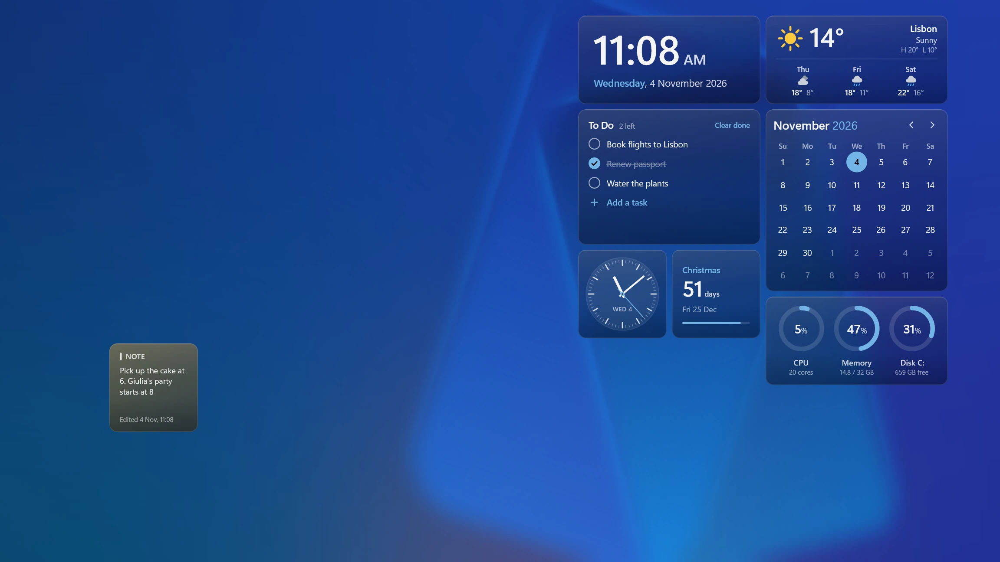

Vitrine is a desktop widget engine for Windows 10 and 11. It draws widgets **beneath your desktop
icons**, on the same layer as the wallpaper, and keeps them **interactive**: a click, hover or scroll
that misses an icon reaches the widget underneath.

## What you get

- **A grid of widgets.** The desktop becomes a grid of 64 DIP cells. Every widget covers a
  rectangle of cells; you move and resize it in **edit layout** (<kbd>Ctrl</kbd>+<kbd>Alt</kbd>+<kbd>V</kbd>),
  while your open windows step aside. Each monitor has its own grid, and the same widget can run as
  many instances as you like, each with its own settings.
- **Essentials, 13 widgets** in the Windows 11 style: clock, analog clock, calendar, weather, system,
  network, battery, drives, to-do, note, links, countdown and progress. Each one comes as frosted
  acrylic or bare on the wallpaper, and follows Windows light and dark mode live.
- **Four themes**, [Sargas, Antares, Mond and Alnitak](/packs/), complete looks drawn straight on
  the wallpaper, each in its own typeface.
- **A control panel** with live previews: every setting shows its effect on the widget as you change it.
- **The [store](/packs/)**, a catalogue of widget packs you install with a double-click.
- **Ten languages**, following the Windows display language.

## Native, not a browser

Vitrine 1 drew its themes with WebView2, a full Chromium engine. Vitrine 2 has its own renderer:

- widget code runs in **QuickJS**, a small embeddable JavaScript engine, with one sandboxed runtime per
  widget and a memory and time budget;
- the widget's UI tree is laid out with **Taffy** (flexbox and grid) and painted with **Direct2D** and
  **DirectWrite**;
- frames are drawn only when something changes, and widgets pause while a full-screen app runs or the
  screen is locked or off.

## Widgets are packs

A **pack** is a `.vitrine` file: a manifest (`vitrine.json`), one JavaScript bundle per widget written
with [`@vitrine/sdk`](https://github.com/vitrine-org/sdk) in TSX and SolidJS, assets such as fonts and
images, and an optional settings schema per widget. Each widget declares the permissions it needs, such
as CPU usage or one weather host, and gets nothing else.

## Where to go next

| If you want to | Read |
| --- | --- |
| Install Vitrine and arrange your desktop | [Install and set up](/docs/getting-started/install/) |
| Write a widget | [Your first widget](/docs/getting-started/first-widget/), then [Build a widget step by step](/docs/guides/building-a-widget/) |
| Make a whole look | [Create a theme](/docs/themes/create-a-theme/) and the [design guidelines](/docs/design/guidelines/) |
| Share your widgets | [Publishing](/docs/publishing/) |
| Look something up | [Reference](/docs/reference/sdk/) |
