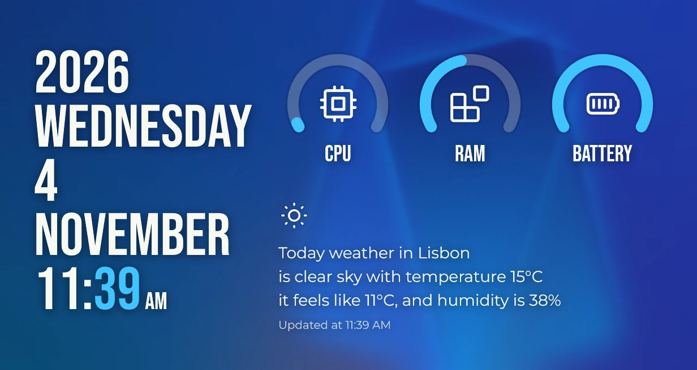

A Vitrine **theme** is an ordinary widget pack whose widgets share one visual identity: the same
typefaces, the same colours, the same way of sitting on the wallpaper. There is no separate theme
format. This page walks through [Sargas](https://github.com/vitrine-org/sargas), one of the four
official themes, and the decisions behind it.



Sargas has three widgets:

| Widget | Id | Default | Min | Max |
| --- | --- | --- | --- | --- |
| Date & time | `datetime` | 3×4 | 2×3 | 6×8 |
| Gauges | `gauges` | 4×2 | 3×1 | 6×3 |
| Weather | `weather` | 5×2 | 4×2 | 7×3 |

## 1. Start from an identity, not from widgets

Before writing code, decide three things and write them down at the top of a shared file:

- **Typefaces.** Sargas pairs a condensed display face, Bebas Neue, for everything large with
  Montserrat for running text. One display face and one text face is enough for any theme.
- **Colour.** Text in one near-white (`#F8F8F2`) or near-black (`#212121`), two dimmer steps of the
  same colour for secondary text, and one accent for the detail that matters: the minutes, the
  gauge arcs.
- **Surface.** Whether the widgets are drawn **bare** on the wallpaper or on a **card**.

Sargas keeps all three in `src/shared/`: `fonts.ts` names the families, `look.tsx` turns the
settings into a palette, and every widget imports from there. A theme that does this stays
consistent when you add the fourth widget a year later.

```ts
// src/shared/fonts.ts: fonts bundled with the pack (SIL Open Font License 1.1).
export const DISPLAY = "Bebas Neue";
export const BODY = "Montserrat";
```

## 2. Bundle the fonts

Fonts ship inside the pack and are declared once in `vitrine.json`. The engine loads them for
every widget of the pack, and you use them by family name.

```json
{
  "id": "dev.vitrine.sargas",
  "name": "Sargas",
  "version": "2.1.1",
  "fonts": ["assets/fonts/BebasNeue-Regular.ttf", "assets/fonts/Montserrat-Regular.ttf"],
  "widgets": [ … ]
}
```

```tsx
<text style={{ fontFamily: DISPLAY, fontSize: 96, lineHeight: 0.9 }}>MONDAY</text>
```

Check the licence of every font before you publish: the store review asks for it, and the pack's
`LICENSE` should name each font and its licence. See [Fonts and assets](/docs/guides/fonts-and-assets/).

## 3. Bare or card

Themes in the Conky tradition draw straight on the wallpaper. That is the most striking look and the
hardest to keep legible, because you don't know the wallpaper. Sargas defaults to **bare** and
offers an **acrylic card** for busy wallpapers, in the same settings section as the theme colour:

```json
"background": {
  "type": "string", "default": "none", "label": "Background",
  "options": [
    { "value": "none", "label": "None (on the wallpaper)" },
    { "value": "acrylic", "label": "Acrylic card" }
  ]
},
"shadow": {
  "type": "boolean", "default": true, "label": "Text shadow",
  "visibleWhen": { "key": "background", "value": "none" }
}
```

On the wallpaper, legibility comes from a soft Gaussian `textShadow` under the text: dark under
light text, a light glow under dark text. On a card, the shadow goes and `backdropFilter` blurs the
wallpaper instead. SVG strokes have no shadow, so Sargas draws a wider, faint "halo" stroke under each
arc. Both techniques are explained in [Glass and legibility](/docs/guides/glass-and-legibility/).

```tsx
// src/shared/look.tsx (abridged): one surface for every widget of the theme.
export function Surface(props: { l: Look; style?: Style; children: (l: Look) => JSX.Element }) {
  return (
    <view
      style={{
        width: "100%",
        height: "100%",
        borderRadius: 8,
        overflow: "hidden",
        color: props.l.text,
        ...(props.l.shadow ? { textShadow: props.l.shadow } : {}),
        ...(props.l.card
          ? {
              background: props.l.dark
                ? "linear-gradient(160deg, rgba(44, 44, 44, 0.72), rgba(28, 28, 28, 0.66))"
                : "linear-gradient(160deg, rgba(252, 252, 252, 0.74), rgba(238, 238, 238, 0.68))",
              backdropFilter: "blur(24px) saturate(1.4)",
            }
          : {}),
        ...props.style,
      }}
    >
      {props.children(props.l)}
    </view>
  );
}
```

## 4. Light, dark and the accent

A bare theme can't guess the wallpaper's brightness, so Sargas lets the user pick **light text**
(for dark wallpapers, the default), **dark text**, or **follow Windows**. The last one reads
[`useAppearance()`](/docs/guides/appearance/), which also supplies the Windows accent colour. The
accent setting accepts `system` or a hex colour, validated by a `pattern`:

```json
"accent": {
  "type": "string", "default": "#40C4FF", "label": "Accent color",
  "pattern": "^(system|#[0-9a-fA-F]{6})$",
  "patternMessage": "Use system or a hex color such as #40C4FF"
}
```

When the accent is `system`, Sargas lightens it on dark text and darkens it on light text, so the
Windows accent always reads against the theme's own text colour.

## 5. Sizes: default, min and max

Each widget declares its size in grid cells. A cell is 64 × 64 DIPs with an 8 DIP gap, so a widget
of *n* cells spans `n × 64 + (n − 1) × 8` DIPs: 3×4 is 208 × 280.

- **default** is the size the widget gets when it is added. Pick the size at which the design is
  at its best, not the smallest one that works.
- **min** is the smallest size at which nothing is cut off. Test it.
- **max** stops the widget where the design falls apart: very wide gauges with tiny text, a date that
  becomes a poster.

Design for the range, not one size. Sargas's Date & time computes its font size from the space it
has, so every size between 2×3 and 6×8 is filled edge to edge:

```tsx
// Bebas Neue is condensed: an average glyph is about 0.41 em wide.
const GLYPH = 0.41;
const LINE = 0.9;

const fontSize = () => {
  const rows = lines().length + (s().showTime ? 1 : 0);
  const widest = Math.max(...lines().map((t) => t.length), s().showTime ? 5 : 0);
  const byH = (size().height - pad() * 2) / (rows * LINE);
  const byW = (size().width - pad() * 2) / (widest * GLYPH);
  return Math.floor(clamp(Math.min(byH, byW), 14, 220));
};
```

`useSize()` is reactive: when the user resizes the widget in edit layout, the text follows on the
next frame.

## 6. Settings that belong to the theme

Keep the same **Appearance** section, with the same keys and defaults, in every widget of the
theme: `theme`, `accent`, `background`, `shadow`, `align`. Users learn it once, and your shared
`look()` reads the same object everywhere. Widget-specific options go in a section of their own
above it (for Date & time: show the year, show the time, 12- or 24-hour clock). The full schema is in
[Settings](/docs/guides/settings/) and the [settings schema reference](/docs/reference/settings-schema/).

## 7. Previews

Every widget needs a `preview.png`: the store rejects a pack without one and shows it on the pack's
page. Render it from the built pack with the real engine:

```sh
npm run build
vitrine render dist datetime --cells 3x4 --scale 2 --out src/datetime/preview.png
vitrine render dist weather --cells 5x2 --scale 2 --network --out src/weather/preview.png
```

- Render at the **default** size and at `--scale 2`, so previews stay sharp on high-DPI screens.
- Use `--network` for widgets that fetch data, or the preview shows an empty state.
- `--backdrop wallpaper.jpg` puts a wallpaper behind `backdropFilter`, which is how you check a card
  over a real picture. Without it, glass blurs a soft default gradient.
- Point `preview` in `vitrine.json` at the file, for example `"preview": "src/datetime/preview.png"`.

## 8. Ship it

Build the `.vitrine` file with `npm run pack`, attach it to a GitHub release and add the pack to the
store. [Publishing](/docs/publishing/) covers the release, the store pull request and updates.

## Checklist

- One display face and one text face, bundled and licensed.
- One shared palette module; every widget reads it.
- Bare and card both legible on a white and on a black wallpaper.
- Light text, dark text and "follow Windows" all tested.
- Every size from min to max looks intentional.
- The same Appearance section in every widget.
- A preview per widget, rendered at the default size and scale 2.
