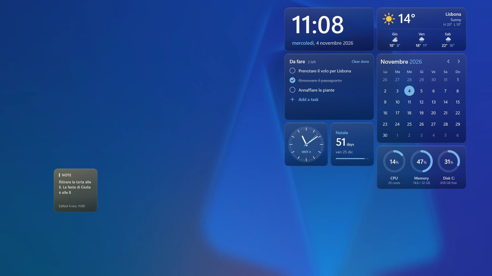

Vitrine è un motore di widget per il desktop di Windows 10 e 11. Disegna i widget **sotto le icone
del desktop**, sullo stesso livello dello sfondo, e li lascia **interattivi**: un clic, un passaggio
del mouse o uno scroll che non prende un'icona arriva al widget sottostante.

## Cosa trovi

- **Una griglia di widget.** Il desktop diventa una griglia di celle da 64 DIP. Ogni widget occupa un
  rettangolo di celle; lo sposti e lo ridimensioni in **Modifica layout**
  (<kbd>Ctrl</kbd>+<kbd>Alt</kbd>+<kbd>V</kbd>), mentre le finestre aperte si fanno da parte. Ogni
  monitor ha la sua griglia, e lo stesso widget può girare in quante istanze vuoi, ognuna con le sue
  impostazioni.
- **Essentials**, incluso: [Conky](/it/packs/#dev.vitrine.essentials), un'unica colonna alta nello
  stile di Windows 11 con ora e data, il meteo se lo vuoi, poi sistema, CPU, memoria, unità, rete e
  batteria. Può essere in acrilico smerigliato o nuda sullo sfondo, e segue dal vivo la modalità
  chiara o scura di Windows.
- **[Vega](/it/packs/#dev.vitrine.vega)**, un pack ufficiale nello store: widget puliti e arrotondati
  per tutti i giorni (orologio, calendario, meteo, batterie, promemoria e una nota), chiari e scuri.
- **Quattro temi**, [Sargas, Antares, Mond e Alnitak](/it/packs/): look completi disegnati
  direttamente sullo sfondo, ognuno con il suo carattere.
- **Un pannello di controllo** con anteprime dal vivo: ogni impostazione mostra subito il suo effetto
  sul widget.
- **Lo [store](/it/packs/)**, un catalogo di pacchetti di widget da installare con un doppio clic.
- **Dieci lingue**, secondo la lingua di visualizzazione di Windows.

## Nativo, non un browser

Vitrine 1 disegnava i temi con WebView2, cioè un intero motore Chromium. Vitrine 2 ha un renderer
proprio:

- il codice dei widget gira in **QuickJS**, un motore JavaScript piccolo e incorporabile, con un
  runtime isolato per ogni widget e un limite di memoria e di tempo;
- l'albero dell'interfaccia viene impaginato con **Taffy** (flexbox e grid) e disegnato con
  **Direct2D** e **DirectWrite**;
- si disegna solo quando qualcosa cambia, e i widget si fermano quando gira un'app a schermo intero o
  lo schermo è bloccato o spento.

## I widget sono pacchetti

Un **pacchetto** è un file `.vitrine`: un manifesto (`vitrine.json`), un bundle JavaScript per widget
scritto con [`@vitrine/sdk`](https://github.com/vitrine-org/sdk) in TSX e SolidJS, risorse come font e
immagini, e uno schema di impostazioni facoltativo per ogni widget. Ogni widget dichiara i permessi che
gli servono, come l'uso della CPU o un singolo host meteo, e non ottiene altro.

## Da dove proseguire

| Se vuoi | Leggi |
| --- | --- |
| Installare Vitrine e sistemare il desktop | [Installazione e primi passi](/it/docs/getting-started/install/) |
| Scrivere un widget | [Il primo widget](/it/docs/getting-started/first-widget/), poi [Un widget passo per passo](/it/docs/guides/building-a-widget/) |
| Creare un look completo | [Creare un tema](/it/docs/themes/create-a-theme/) e le [linee guida di design](/it/docs/design/guidelines/) |
| Condividere i tuoi widget | [Pubblicazione](/it/docs/publishing/) |
| Cercare un dettaglio | [Riferimento](/it/docs/reference/sdk/) |
