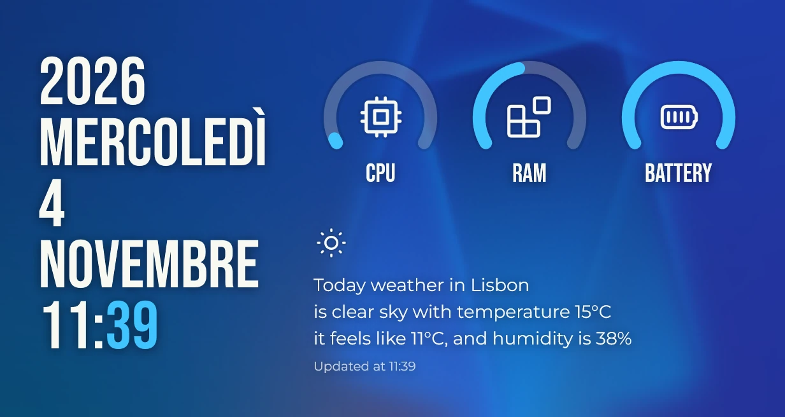

Per Vitrine un **tema** è un normale pacchetto di widget in cui tutti i widget condividono la stessa
identità visiva: stessi caratteri, stessi colori, stesso modo di stare sullo sfondo. Non esiste un
formato a parte. In questa pagina smontiamo [Sargas](https://github.com/vitrine-org/sargas), uno dei
quattro temi ufficiali, e le scelte che ci stanno dietro.



Sargas ha tre widget:

| Widget | Id | Predefinita | Minima | Massima |
| --- | --- | --- | --- | --- |
| Data e ora | `datetime` | 3×4 | 2×3 | 6×8 |
| Indicatori | `gauges` | 4×2 | 3×1 | 6×3 |
| Meteo | `weather` | 5×2 | 4×2 | 7×3 |

## 1. Prima l'identità, poi i widget

Prima di scrivere codice, fissa tre decisioni in un file condiviso:

- **Caratteri.** Sargas abbina un carattere condensato da titolo, Bebas Neue, per tutto ciò che è
  grande, a Montserrat per il testo corrente. Un carattere da titolo e uno da testo bastano per
  qualunque tema.
- **Colore.** Il testo in un quasi bianco (`#F8F8F2`) o in un quasi nero (`#212121`), due gradi più
  tenui dello stesso colore per il testo secondario, e un solo accento per il dettaglio che conta: i
  minuti, gli archi degli indicatori.
- **Superficie.** Se i widget stanno **nudi** sullo sfondo o su una **scheda**.

Sargas tiene tutto in `src/shared/`: `fonts.ts` dà il nome alle famiglie, `look.tsx` trasforma le
impostazioni in una palette, e ogni widget importa da lì. Un tema costruito così resta coerente anche
quando, fra un anno, aggiungerai il quarto widget.

```ts
// src/shared/fonts.ts: fonts bundled with the pack (SIL Open Font License 1.1).
export const DISPLAY = "Bebas Neue";
export const BODY = "Montserrat";
```

## 2. Includere i caratteri

I font viaggiano dentro il pacchetto e si dichiarano una volta sola in `vitrine.json`. Il motore li
carica per tutti i widget del pacchetto, e tu li usi per nome di famiglia.

```json
{
  "id": "dev.vitrine.sargas",
  "name": "Sargas",
  "version": "2.1.1",
  "fonts": ["assets/fonts/BebasNeue-Regular.ttf", "assets/fonts/Montserrat-Regular.ttf"],
  "widgets": [ … ]
}
```

```tsx
<text style={{ fontFamily: DISPLAY, fontSize: 96, lineHeight: 0.9 }}>MONDAY</text>
```

Controlla la licenza di ogni font prima di pubblicare: la revisione dello store la chiede, e il
`LICENSE` del pacchetto deve citare ogni font con la sua licenza. Vedi
[Font e risorse](/it/docs/guides/fonts-and-assets/).

## 3. Nudo o su scheda

I temi nella tradizione di Conky disegnano direttamente sullo sfondo. È il risultato più d'effetto e
il più difficile da tenere leggibile, perché lo sfondo non lo conosci. Sargas parte **nudo** e offre
una **scheda acrilica** per gli sfondi movimentati, nella stessa sezione del colore del testo:

```json
"background": {
  "type": "string", "default": "none", "label": "Background",
  "options": [
    { "value": "none", "label": "None (on the wallpaper)" },
    { "value": "acrylic", "label": "Acrylic card" }
  ]
},
"shadow": {
  "type": "boolean", "default": true, "label": "Text shadow",
  "visibleWhen": { "key": "background", "value": "none" }
}
```

Sullo sfondo, la leggibilità viene da un `textShadow` gaussiano morbido sotto il testo: scuro sotto
il testo chiaro, un alone chiaro sotto quello scuro. Sulla scheda l'ombra sparisce e `backdropFilter`
sfoca invece lo sfondo. I tratti SVG non hanno ombra, quindi Sargas disegna sotto ogni arco un tratto
più largo e tenue, un "alone". Entrambe le tecniche sono spiegate in
[Vetro e leggibilità](/it/docs/guides/glass-and-legibility/).

```tsx
// src/shared/look.tsx (abridged): one surface for every widget of the theme.
export function Surface(props: { l: Look; style?: Style; children: (l: Look) => JSX.Element }) {
  return (
    <view
      style={{
        width: "100%",
        height: "100%",
        borderRadius: 8,
        overflow: "hidden",
        color: props.l.text,
        ...(props.l.shadow ? { textShadow: props.l.shadow } : {}),
        ...(props.l.card
          ? {
              background: props.l.dark
                ? "linear-gradient(160deg, rgba(44, 44, 44, 0.72), rgba(28, 28, 28, 0.66))"
                : "linear-gradient(160deg, rgba(252, 252, 252, 0.74), rgba(238, 238, 238, 0.68))",
              backdropFilter: "blur(24px) saturate(1.4)",
            }
          : {}),
        ...props.style,
      }}
    >
      {props.children(props.l)}
    </view>
  );
}
```

## 4. Chiaro, scuro e l'accento

Un tema nudo non può indovinare quanto è luminoso lo sfondo, quindi Sargas lascia scegliere
**testo chiaro** (per sfondi scuri, il predefinito), **testo scuro** o **come Windows**. L'ultima
opzione legge [`useAppearance()`](/it/docs/guides/appearance/), che fornisce anche il colore d'accento
di Windows. L'impostazione dell'accento accetta `system` o un colore esadecimale, validato da un
`pattern`:

```json
"accent": {
  "type": "string", "default": "#40C4FF", "label": "Accent color",
  "pattern": "^(system|#[0-9a-fA-F]{6})$",
  "patternMessage": "Use system or a hex color such as #40C4FF"
}
```

Con `system`, Sargas schiarisce l'accento sul testo chiaro e lo scurisce sul testo scuro: così
l'accento di Windows si legge sempre accanto al colore del tema.

## 5. Dimensioni: predefinita, minima e massima

Ogni widget dichiara la sua dimensione in celle della griglia. Una cella misura 64 × 64 DIP con
8 DIP di spazio fra le celle, quindi un widget di *n* celle occupa `n × 64 + (n − 1) × 8` DIP: un 3×4
è 208 × 280.

- **default** è la dimensione con cui il widget viene aggiunto. Scegli quella in cui il disegno rende
  meglio, non la più piccola che funziona.
- **min** è la dimensione più piccola in cui niente viene tagliato. Va provata.
- **max** ferma il widget prima che il disegno si sfaldi: indicatori larghissimi con testo minuscolo,
  una data che diventa un manifesto.

Progetta per l'intervallo, non per una misura. Data e ora di Sargas calcola la dimensione del testo
dallo spazio disponibile, così ogni misura fra 2×3 e 6×8 è piena da bordo a bordo:

```tsx
// Bebas Neue is condensed: an average glyph is about 0.41 em wide.
const GLYPH = 0.41;
const LINE = 0.9;

const fontSize = () => {
  const rows = lines().length + (s().showTime ? 1 : 0);
  const widest = Math.max(...lines().map((t) => t.length), s().showTime ? 5 : 0);
  const byH = (size().height - pad() * 2) / (rows * LINE);
  const byW = (size().width - pad() * 2) / (widest * GLYPH);
  return Math.floor(clamp(Math.min(byH, byW), 14, 220));
};
```

`useSize()` è reattivo: quando l'utente ridimensiona il widget in Modifica layout, il testo si adegua
al fotogramma successivo.

## 6. Impostazioni del tema

Ripeti la stessa sezione **Aspetto**, con le stesse chiavi e gli stessi valori predefiniti, in ogni
widget del tema: `theme`, `accent`, `background`, `shadow`, `align`. L'utente la impara una volta, e la
tua `look()` condivisa legge ovunque lo stesso oggetto. Le opzioni proprie del widget vanno in una
sezione a sé, sopra (per Data e ora: mostra l'anno, mostra l'ora, formato a 12 o 24 ore). Lo schema
completo è in [Impostazioni](/it/docs/guides/settings/) e nel
[riferimento dello schema](/it/docs/reference/settings-schema/).

## 7. Anteprime

Ogni widget ha bisogno di un `preview.png`: lo store rifiuta i pacchetti che ne sono privi e la mostra
nella pagina del pacchetto. Generala dal pacchetto compilato, con il motore vero:

```sh
npm run build
vitrine render dist datetime --cells 3x4 --scale 2 --out src/datetime/preview.png
vitrine render dist weather --cells 5x2 --scale 2 --network --out src/weather/preview.png
```

- Usa la dimensione **predefinita** e `--scale 2`, così l'anteprima resta nitida sugli schermi ad alta
  densità.
- Aggiungi `--network` ai widget che scaricano dati, altrimenti l'anteprima mostra lo stato vuoto.
- `--backdrop sfondo.jpg` mette un'immagine dietro `backdropFilter`: è il modo per verificare una
  scheda sopra una foto vera. Senza, il vetro sfoca una sfumatura predefinita.
- In `vitrine.json`, `preview` punta al file, per esempio `"preview": "src/datetime/preview.png"`.

## 8. Pubblicare

Crea il file `.vitrine` con `npm run pack`, allegalo a una release GitHub e aggiungi il pacchetto allo
store. [Pubblicazione](/it/docs/publishing/) spiega la release, la pull request allo store e gli
aggiornamenti.

## Lista di controllo

- Un carattere da titolo e uno da testo, inclusi e con licenza.
- Un solo modulo di palette condiviso, letto da ogni widget.
- Versione nuda e su scheda leggibili sia su uno sfondo bianco sia su uno nero.
- Testo chiaro, testo scuro e "come Windows" provati tutti e tre.
- Ogni dimensione fra minima e massima sembra voluta.
- La stessa sezione Aspetto in ogni widget.
- Un'anteprima per widget, alla dimensione predefinita e in scala 2.
